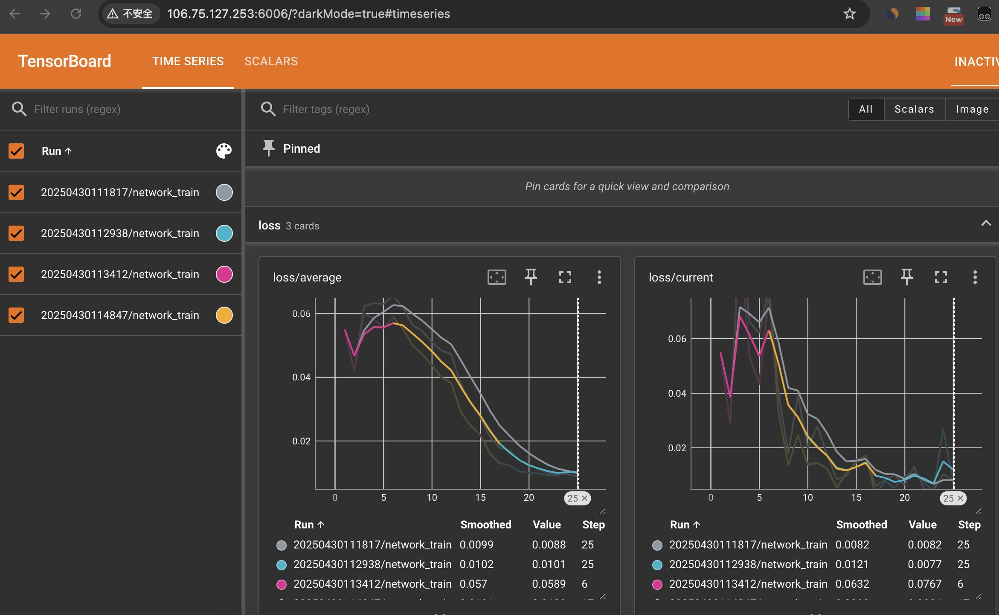

# Mathematical Proof Visualization with Manim & Neural Voice Conversion

An independent computational project combining **Python-based mathematical animation** and **deep learning-based voice conversion** to create an educational video explaining fundamental mathematical proof techniques for my high school Linear Algebra project.

This project explores how mathematical visualization, neural speech processing, and programming can be integrated into a single educational application.

## Project Demo

The completed video introduces four mathematical proof techniques through animations created using Manim, accompanied by AI-generated narration.

**[Watch the Final Video](finalmathproofs.mp4)**

## Technologies Used

| Technology | Application |
|---|---|
| Python | Programming mathematical animations |
| Manim | Generating mathematical visualizations |
| Retrieval-Based Voice Conversion (RVC) | Neural voice conversion architecture |
| Applio | Interface for preprocessing audio and training the RVC model |
| PyTorch | Deep learning framework underlying the training pipeline |
| Google Colab | GPU-accelerated model training |
| TensorBoard | Visualizing neural network training metrics |
| Audio Preprocessing | Preparing speech data for model training |

## 1. Mathematical Visualization with Manim

I used [Manim](https://www.manim.community/), an open-source Python library for mathematical animations, to programmatically illustrate four methods of mathematical proof.

Unlike traditional animation software, Manim allows animations to be defined using Python code. Mathematical expressions, transformations, and visual sequences can be constructed and controlled programmatically.

The project involved translating abstract mathematical reasoning into visual explanations.

### Proof Techniques

| Proof Technique | Source Code |
|---|---|
| Direct Proof | [directproof.py](directproof.py) |
| Proof by Contrapositive | [contrapositive.py](contrapositive.py) |
| Proof by Contradiction | [contradiction.py](contradiction.py) |
| Mathematical Induction | [InductionProof.py](InductionProof.py) |
| Additional Contradiction Script | [testproofbycontradiction.py](testproofbycontradiction.py) |

The individual animations were combined into a narrated video designed to make mathematical reasoning more accessible.

## 2. Neural Voice Conversion with Applio

For the video's narration, I experimented with **Retrieval-Based Voice Conversion (RVC)** using [Applio](https://github.com/IAHispano/Applio), an open-source application that provides a workflow for training and using RVC voice conversion models.

The objective was to train a model capable of transforming source narration into a voice resembling a target speaker.

### Dataset Preparation

I prepared a speech dataset using approximately **16 minutes of audio** extracted from educational videos by 3Blue1Brown.

The preprocessing workflow involved:

1. Extracting speech audio from video recordings.
2. Manually removing segments containing background music and interfering sounds.
3. Preparing the cleaned speech recordings for the Applio training pipeline.

This process introduced me to the importance of dataset quality and audio preprocessing in machine learning applications.

### Model Training

I used **Applio in Google Colab** to train an RVC voice conversion model using GPU acceleration.

RVC uses neural speech representations to preserve linguistic content while learning to reproduce characteristics of a target speaker's voice. Its retrieval-based component uses features extracted from the training dataset to support voice conversion.

The workflow involved:

- Preprocessing audio and extracting speech features using Applio's RVC pipeline.
- Training a voice conversion model using an existing RVC architecture.
- Running GPU-accelerated training in Google Colab.
- Monitoring generator and discriminator losses through TensorBoard.
- Using the trained model to convert narration for the final video.

The underlying RVC architecture was not developed from scratch as part of this project.

### Training Visualization with TensorBoard

I used **TensorBoard through Applio's training workflow** to visualize neural network training metrics.



*TensorBoard visualization of RVC model training through Applio in Google Colab, showing generator and discriminator loss metrics over approximately 4,000 training steps.*

The dashboard includes multiple loss components associated with the model's adversarial training process, including discriminator loss, generator loss, and KL divergence.

Monitoring these metrics provided practical exposure to neural network optimization and the challenges of interpreting training behavior. Loss curves alone do not establish the perceptual quality of generated speech.

### Narration Generation

After training, I used the RVC model through Applio to transform source narration into the target voice and integrated the converted audio with the Manim animations.

RVC performs speech-to-speech conversion rather than directly converting written text into speech. The voice conversion stage therefore operates on an existing speech recording.

## 3. Project Workflow

The overall development process combined two computational workflows.

**Mathematical Animation**

Mathematical proof → Python/Manim implementation → Rendered animations

**Neural Voice Conversion**

Audio dataset → Audio preprocessing → Feature extraction → RVC model training with Applio → Voice conversion

**Final Integration**

Rendered animations + Converted narration → Completed educational video

## 4. Skills and Concepts Explored

### Programming and Mathematical Visualization

- Python scripting and animation development
- Programmatic manipulation of mathematical expressions
- Translating abstract mathematical concepts into visual representations
- Integrating independently generated animation sequences

### Machine Learning and Audio Processing

- Preparing and cleaning speech datasets
- Training an existing RVC architecture using Applio
- Running GPU-accelerated machine learning workflows in Google Colab
- Monitoring training behavior using TensorBoard
- Working with neural speech representations and feature extraction
- Integrating converted speech into a multimedia project

## 5. Repository Structure

```text
manim-video/
├── README.md
├── .gitattributes
├── InductionProof.py
├── contradiction.py
├── contrapositive.py
├── directproof.py
├── testproofbycontradiction.py
├── finalmathproofs.mp4
└── rvc-training-tensorboard.png
```

The repository includes the Python source code for the mathematical animations, the completed video, and a screenshot documenting the voice model training process.

## 6. Reproducibility and Limitations

The Manim animation scripts are available for inspection and reuse, subject to the dependencies and environment required by the original implementation.

The original Applio/RVC training notebooks, processed audio dataset, and model checkpoints were lost during the transfer of my high school Google Drive account following graduation.

As a result, the original voice conversion training process cannot currently be reproduced from the files in this repository.

The TensorBoard screenshot was retained as documentation of the training process.

This project demonstrates the application and integration of existing software frameworks rather than the development of a new neural network architecture.

## 7. Credits and Responsible Use

- [Manim Community](https://www.manim.community/) — Open-source mathematical animation framework
- [Applio](https://github.com/IAHispano/Applio) — Open-source application for RVC voice conversion and model training
- [3Blue1Brown](https://www.3blue1brown.com/) — Educational speech reference used in the voice conversion experiment

The RVC experiment was conducted for educational purposes. The synthesized voice was not an authentic recording or authorized narration by the original speaker. This project is not affiliated with or endorsed by 3Blue1Brown.

The original speech recordings and trained voice model weights are not distributed in this repository.

## 8. Project Reflection

This project gave me experience integrating tools from mathematical programming, machine learning, and multimedia production into a completed application.

The mathematical visualization component strengthened my ability to represent abstract mathematical ideas through code. The voice conversion component introduced me to neural audio processing, dataset preparation, GPU-based model training, and monitoring deep learning models.

Together, these components provided an opportunity to explore how computational methods can support educational communication and the generation of audiovisual content.
